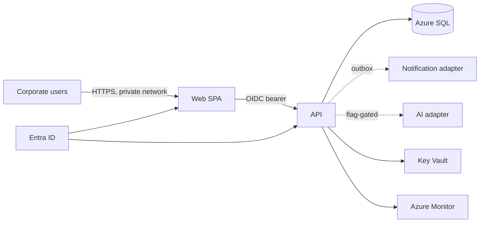

# Architecture

This document proposes the architecture for Procurement Service and the MVP phase (REQ-001 to REQ-010).

Status: DRAFT | Version: 0.2 | Owner: Chief of Staff (architect role) | Brief: 0.4

Nothing here exists yet. No Azure resource, repository, or code has been created. Azure service capabilities below come from general knowledge and are NOT yet verified against Microsoft Learn (the documentation connector failed to connect in this session). Verify before approval.

## Components And Boundaries

Style: a modular monolith. One deployable API, one SPA, one database, because the load is small (about 50 users), the team is small, and strong module boundaries are cheaper to keep than a distributed system is to operate.

| Component | Responsibility | Technology/service | Interface | Data/trust boundary |
| --- | --- | --- | --- | --- |
| Web SPA | Screens for the four roles | React + TypeScript (Vite), static files served by the same App Service as the API | CTR-API | Browser is untrusted; tokens only, no secrets |
| API | Request, Sourcing, Supplier modules; state machines; authorization | ASP.NET Core Web API on Azure App Service | CTR-API (OpenAPI) | Trust boundary: every call validated and authorized server-side |
| Access module | Map Entra app roles and category-to-approver rules to permissions; resource-level checks (Requester sees own requests) | In-API module | internal | Rules in SQL, roles from Entra |
| Audit module | Append-only record of every state change (REQ-008) | Azure SQL ledger table, insert-only | internal | App identity has INSERT and SELECT only |
| Notification adapter | Deliver notices to approver/buyer (REQ-009) | Outbox table + worker; Microsoft Graph mail/Teams | CTR-NOTIFY | Outbound only; failure never blocks the flow |
| AI adapter | Quote comparison summary labeled AI-generated (REQ-010) | Microsoft Foundry + Semantic Kernel behind an interface; off by default | CTR-AI | Sends quote data to the model endpoint; blocked until DEC-001 |
| Database | System of record | Azure SQL Database | schema CTR-DB | Private endpoint only |
| Identity | Sign-in and roles | Microsoft Entra ID (OIDC, app roles) | OIDC | Customer tenant |
| Secrets/config | No secrets in code | Key Vault, managed identity, App Configuration (feature flags) | n/a | Managed identity, no stored keys |
| Observability | Logs, traces, alerts | Application Insights + Azure Monitor | n/a | No personal data in logs |
| IaC | Reproducible environments | Bicep | n/a | Resource creation needs separate authorization |

Data flow: browser signs in at Entra, gets a token, calls the API; the API validates the token and role, checks resource-level rules, runs the state transition and the audit insert in one SQL transaction, and writes a notification to the outbox in the same transaction. Identity propagates as the Entra object ID, which becomes the actor in audit entries. Error paths: invalid transition returns a 409 with the current state; stale edits are rejected by row versioning; notification or AI failure is recorded and surfaced, and never rolls back the business action.

State machine (Request): DRAFT -> SUBMITTED -> APPROVED | REJECTED; APPROVED -> RFQ_OPEN -> RFQ_CLOSED -> AWARDED. Illegal transitions are rejected centrally in the domain layer.

## Decisions

| ID | Decision | Alternatives | Rationale/evidence | Consequences |
| --- | --- | --- | --- | --- |
| ADR-001 | Modular monolith | Microservices; Power Platform low-code | Small scale; the hard part is the state machine and audit, easier in one transaction boundary | Module boundaries must be enforced by tests; splitting later costs work |
| ADR-002 | .NET 10 LTS ASP.NET Core API + React/TypeScript SPA, one App Service (DEC-005) | Python/FastAPI; Power Apps | Fits the Microsoft stack and Entra integration; strong typing for state machines | Team needs .NET and TypeScript skills |
| ADR-003 | Azure SQL Database, relational model | Cosmos DB; Fabric | Transactions and constraints matter more than scale; ledger table suits audit | Single region by default; backup and restore must be verified, not assumed |
| ADR-004 | Immutable audit via insert-only ledger table and least-privilege app identity | Plain table with trigger; event store | Matches REQ-008; DB-level enforcement beats application convention | Admin reads through a read-only view; ledger availability to be verified |
| ADR-005 | Entra ID app roles + category-to-approver table | Custom user store; Azure AD B2C | Enterprise users, single tenant, SSO is the norm | External suppliers are out of MVP (REQ-011 deferred) |
| ADR-006 | Private network by default: VNet integration + private endpoints, no public data plane | Public endpoints with IP filters; fully on-premises | Keeps "local" within Factory rules and works for DEC-001 option 1; hybrid reachable later via VPN/ExpressRoute | DEC-001 resolved: private network on Azure. App Service chosen over Container Apps for fewer moving parts and deployment slots |
| ADR-007 | AI isolated behind an adapter and an App Configuration flag, default OFF | Build AI into the core flow | Must Haves work without cloud AI; AI is Should | If DEC-001 is "no cloud", REQ-010 needs a separate decision |
| ADR-008 | Outbox pattern for notifications | Direct send in request | Business action must not depend on mail availability | Needs a worker and retry policy |

## Exclusive Ownership

Repository: `juliopessan/copilot-agent-factory` (DEC-002). Product paths below are relative to `projects/procurement-service/`, except CI workflows, which GitHub only reads from the repository root `.github/workflows/`; product workflows there must be named `procurement-*.yml`, stay owned by Chief of Staff, and satisfy the kit validator (pinned actions, read-only `contents`). Contracts, shared files, CI, and schemas belong to Chief of Staff. Security Reviewer is read-only.

| Exact path or directory | Exclusive owner | Exclusions/read-only dependencies | Reason |
| --- | --- | --- | --- |
| Root manifests: global.json, Directory.Build.props, solution file, package.json, lockfiles; `.github/workflows/`; `docs/factory/` | Chief of Staff | none | Central integration and shared config |
| `contracts/` (OpenAPI CTR-API, CTR-NOTIFY, CTR-AI, DB schema and migrations) | Chief of Staff | read-only for all specialists | Contracts gate dispatch |
| `infra/` (Bicep) | Chief of Staff | needs separate authorization to deploy | Shared environment definition |
| `src/web/` | Frontend Engineer | `contracts/` read-only | UI |
| `src/api/Domain`, `src/api/Modules`, `src/api/Api` | Backend Engineer | `src/api/Adapters` excluded | Domain, state machines, API |
| `src/api/Adapters/` | Integrations Engineer | domain files read-only | Graph mail/Teams and Foundry access |
| `tests/acceptance/`, `tests/contract/` | QA Engineer | product code read-only | Independent acceptance checks |
| `docs/runbook/`, `README.md` | Documentation Engineer | `docs/factory/` excluded | Verified setup and runbook |

Because this session runs in Claude Code, Copilot specialist profiles are NOT CHECKED. Dispatch will use manual task packets per `templates/TASK_CONTRACT.md` unless the delegation tools are confirmed.

## Validation And Operations

All checks are proposed and NOT RUN.

| Concern | Target | Check/command | Owner | Prerequisite |
| --- | --- | --- | --- | --- |
| Authorization (REQ-001) | Denied for wrong role; logged | Contract + acceptance tests per role matrix | QA Engineer | CTR-API, test identities |
| State machine (REQ-002 to 007) | Illegal transitions rejected | Unit + integration tests against a real SQL instance | Backend Engineer, QA | Local SQL instance |
| Audit immutability (REQ-008) | UPDATE/DELETE by app identity fails | Integration test with the app's DB role | QA Engineer | Ledger table available in the target |
| Security | No blocking findings | Security review of integrated result, dependency and secret scan | Security Reviewer | Integrated build |
| Accessibility | WCAG 2.1 AA, main flows | Automated scan plus manual keyboard pass | QA Engineer | Frontend build |
| Performance | p95 < 2 s at about 50 users [ASSUMPTION] | Load test in a non-prod environment | QA Engineer | Environment, authorization |
| Recovery | Restore verified | Restore drill before release | Customer IT operating owner (named before UAT) | Environment |
| AI safety (REQ-010) | Labeled, never auto-awards | Evaluation set + review | Security, QA | DEC-001 |

Local development: SQL Server container or LocalDB, Entra test tenant or a documented dev-token stub (clearly a test double), notification adapter stubbed, AI adapter off. Live Azure, mail, and Foundry stay NOT RUN until authorized. Credentials are never recorded.

## Approval

| Architecture version | Contract version | Plan version | Ownership revision | Human approval reference/time | State |
| --- | --- | --- | --- | --- | --- |
| 0.2 | 0.2 (proposed) | 0.3 (proposed) | 0.1 (proposed above) | NOT APPROVED | DRAFT |

Open items: DEC-002 (durable repository) blocks scaffolding; budget blocks environment creation; the customer operating owner is needed before UAT. Azure capability assumptions (ledger tables, private endpoints, slots) still need verification against Microsoft Learn.

## Next Steps

1. Resolve the blocking decisions above and verify the Azure assumptions against Microsoft Learn.
2. Draft contracts (OpenAPI, DB schema), the implementation plan, and the test strategy, release plan, and runbook working copies.
3. Obtain human approval of named versions before scaffolding product code.
